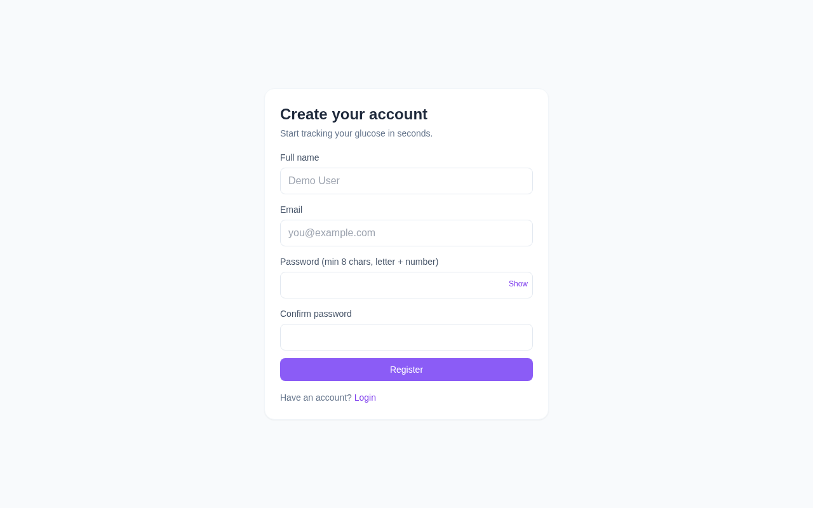
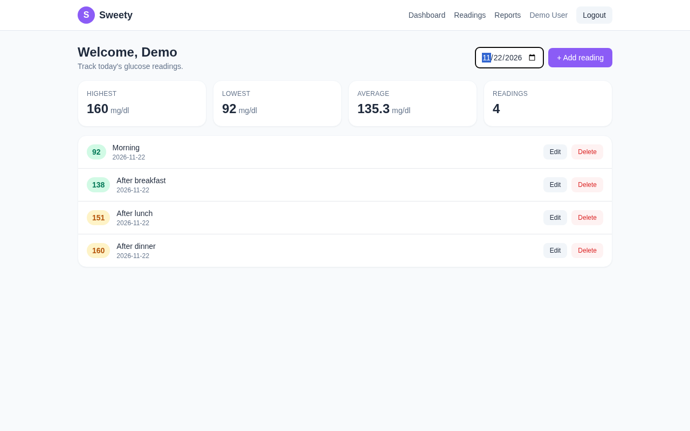

# Sweety – Blood Glucose Tracker

Track daily blood glucose readings (up to 4/day across 4 time slots) with daily and monthly reports. Built for the Kenpath Junior Full Stack Developer assignment (React + Express + PostgreSQL).

## Features

- JWT auth (register / login / logout) with bcrypt hashing
- Readings CRUD, strictly per-user, with pagination and time-slot filter
- Business rules enforced frontend + backend: required value, whole number 40–600 mg/dl, one reading per slot/day, max 4/day, no future dates, DB unique + check constraints
- Reports: daily, month-to-date, previous month — high / low / average (1 decimal) / count, Recharts trend, slot filter, friendly empty state

## Tech Stack

React 19 · Vite · Tailwind · React Router · Axios · Recharts — Express · Prisma · PostgreSQL 18 · JWT · bcryptjs — Jest · Supertest — Docker Compose (Postgres)

## Quickstart

```bash
git clone https://github.com/siddhid1/sweety.git && cd sweety

# 1. Database
docker compose up -d                                   # Postgres on :5433

# 2. Backend (http://localhost:5000)
cp .env.example server/.env                            # then fill in secrets
cd server && npm install && npx prisma migrate deploy && npm run db:seed && npm run dev

# 3. Frontend (http://localhost:5173)
cd client && npm install && npm run dev                # set VITE_API_URL in client/.env

# 4. Tests (separate sweety_test DB, dev data untouched)
cd server && npm test                                  # 23 tests
```

`server/.env` needs `DATABASE_URL`, `DATABASE_URL_TEST`, `JWT_SECRET`, `PORT`, `CLIENT_URL`/`CLIENT_URLS`. See `.env.example`. Never commit real secrets.

## Demo Accounts

Password for all: `Demo@12345`

| Email | Data |
|---|---|
| demo@example.com | 13 curated readings |
| anaya / rahul / priya / arjun / kavya @example.com | ~90–140 readings each over 30–45 days |

Re-run `npm run db:seed` anytime — it upserts, never duplicates.

## API

Base `http://localhost:5000/api` · protected routes take `Authorization: Bearer <JWT>` · errors are `{ success: false, message }`.

| Method | Endpoint | Notes |
|---|---|---|
| POST | `/api/auth/register` | `{ name, email, password }` → `{ user, token }` |
| POST | `/api/auth/login` | `{ email, password }` → `{ user, token }` |
| GET | `/api/auth/me` | current user |
| GET | `/api/readings?page&limit&timeSlot` | own readings, newest first |
| POST | `/api/readings` | `{ readingDate: "2026-10-15", timeSlot: "AFTER_LUNCH", value: 145 }` |
| GET / PUT / DELETE | `/api/readings/:id` | 404 unless yours |
| GET | `/api/reports/daily?date&timeSlot` | stats + readings for the day |
| GET | `/api/reports/month-to-date?date&timeSlot` | stats for 1st → date |
| GET | `/api/reports/monthly?date&timeSlot` | stats for full previous month |

`timeSlot` ∈ `MORNING, AFTER_BREAKFAST, AFTER_LUNCH, AFTER_DINNER`. Empty ranges return `count: 0` with nulls (never fake zeros).

## Screenshots

| Login | Register |
|---|---|
|  |  |

| Dashboard | Readings | Reports |
|---|---|---|
|  |  |  |

## Notes

- `readingDate` is a plain calendar `DATE` compared as `YYYY-MM-DD` — no timezone shifting.
- Auth tokens live in `localStorage` per the assignment's persistence requirement (httpOnly cookies would be the production choice).
- Out of scope by design: roles, Redis, queues, doctor accounts — see bonus priority list in the brief.
